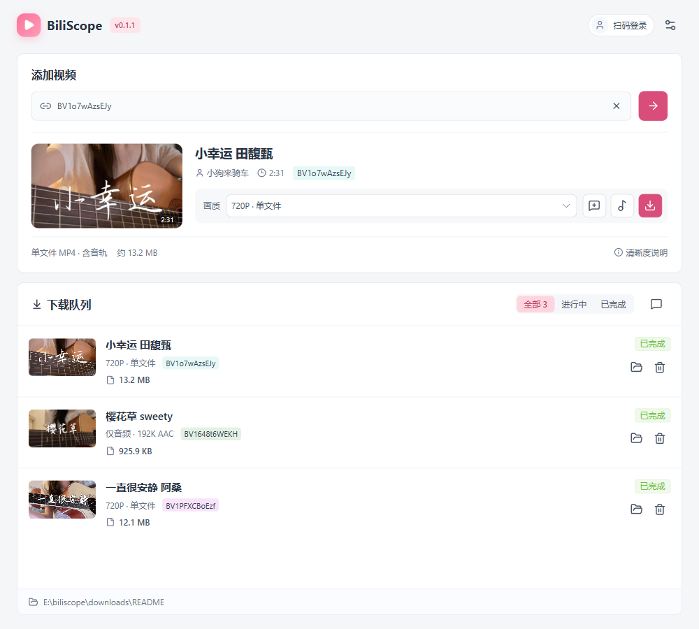

<p align="center">
  
</p>
<h1 align="center">BiliScope</h1>
<p align="center">下载视频，保存原音轨，整理评论。</p>
<p align="center">Windows 桌面工具 · Vue 3 + TypeScript · Tauri 2 + Rust</p>
<p align="center">
  <a href="https://github.com/CrazySand/biliscope/releases">下载与版本发布</a> ·
  <a href="#快速开始">快速开始</a> ·
  <a href="#使用说明">使用说明</a> ·
  <a href="https://github.com/CrazySand/biliscope/issues">反馈问题</a>
</p>

BiliScope 是一个面向 Windows 的 B 站视频下载与评论管理工具。粘贴视频链接或 BV 号，即可查看可用画质、选择分集、下载视频或音频；也可以把视频加入评论任务，采集、保存并导出主评论。

当前版本 **v0.1.1**，仍处于早期迭代阶段。可用清晰度、音质和评论范围以 B 站接口及当前账号权限为准。

## 界面预览

### 视频解析与下载队列



### 评论记录与导出


> 配图来自 v0.1.1 桌面开发版的实际操作：视频解析、视频/音频下载及评论采集均真实完成。下载截图使用独立的未登录会话；评论截图为登录后采集热门前 5 页的实际结果，共保存 77 条主评论。可用资源与评论数量可能随账号权限和平台接口变化。

截图中的视频均来自 UP 主「小狗来骑车」：

- [一直很安静 阿桑](https://www.bilibili.com/video/BV1PFXCBoEzf/)：视频下载。
- [樱花草 sweety](https://www.bilibili.com/video/BV1648t6WEKH/)：仅音频下载。
- [小幸运 田馥甄](https://www.bilibili.com/video/BV1o7wAzsEJy/)：视频下载与热门主评论采集。

以上三个视频均为单 P；分集功能见下文使用说明。

## 功能一览

| 功能 | 说明 |
| --- | --- |
| 视频解析 | 支持 BV 号、完整视频链接，展示封面、UP 主、时长和可用画质 |
| 分 P 选择 | 下拉搜索分集，或通过前后按钮切换；下载当前选中的分集 |
| 视频下载 | 支持 DASH 音视频合并及单文件视频 |
| 仅音频下载 | 自动选择最高档可用音轨，保留原编码，不强制转换 MP3 |
| 下载队列 | 支持 1–4 个并发任务、进度和速度、取消、失败重试、文件定位 |
| 扫码登录 | 使用 B 站手机 App 扫码确认，登录状态保存在本机 |
| 评论采集 | 按热门或最新采集前 N 页或全部可见主评论 |
| 评论管理 | 本地保存、重复采集去重合并、分页查看、按视频删除 |
| 数据导出 | 将已保存的主评论导出为 CSV 或 JSON |
| 环境设置 | 设置保存目录、下载并发数、重新检测 FFmpeg |

## 快速开始

### 1. 准备运行环境

面向 **Windows 10/11 x64**。使用已打包的应用不需要安装 Node.js、Rust 或 Python。

必须先安装 **FFmpeg** 并让 `ffmpeg` 命令可从 `PATH` 找到。在 PowerShell 或 CMD 中执行：

```powershell
winget install --id Gyan.FFmpeg -e
```

安装后重新打开终端，检查：

```powershell
ffmpeg -version
where.exe ffmpeg
```

如果没有 `winget`，可从 [FFmpeg 下载页](https://ffmpeg.org/download.html)选择 Windows 构建，将包含 `ffmpeg.exe` 的目录加入 `PATH`。WinGet 包对应 [Microsoft 社区清单中的 Gyan.FFmpeg](https://github.com/microsoft/winget-pkgs/tree/master/manifests/g/Gyan/FFmpeg)。

**所有视频和音频下载均需要 FFmpeg。** 即使某个视频是自带音轨的单文件，应用也会统一检查该依赖。FFmpeg 不随安装包分发。

### 2. 安装 BiliScope

1. 打开 [Releases](https://github.com/CrazySand/biliscope/releases)，若已有发布，下载 `BiliScope_<版本>_x64-setup.exe`。若尚未提供安装包，按下文从源码构建。
2. 退出正在运行的旧版 BiliScope，然后运行安装包，选择安装目录。
3. 安装程序会检查 `PATH` 中的 FFmpeg；找不到时会停止安装。
4. 若缺少 **Microsoft Edge WebView2 Runtime**，安装程序会尝试联网下载并安装，因此首次安装可能需要网络连接。

### 3. 完成首次下载

打开应用 → 粘贴 BV 号或视频链接 → 点击右箭头解析 → 选择分集和画质 → 点击下载图标。

默认保存到 Windows 用户的“下载”目录下的 `BiliScope` 文件夹；可通过右上角设置修改。

## 使用说明

### 解析视频与登录

输入框支持：

```text
BV19nhA65Ewo
https://www.bilibili.com/video/BV19nhA65Ewo/
```

解析后会展示视频信息及可用清晰度。当前尚不支持 `b23.tv` 短链接或 `av` 号；遇到分享短链时，先在浏览器打开并复制完整视频地址。

点击右上角“扫码登录”，用 B 站手机 App 扫描二维码并确认。登录后重新解析视频，以刷新可用资源。登录不代表获得全部画质：高清、HDR、杜比等资源仍受视频本身、账号权限及会员状态影响。

### 选择分 P

分 P 是同一投稿下的多个分集，共用一个 BV 号。解析后默认展示第一集，请通过分集控件选择要下载的内容。存在多个分集时，视频卡片会显示“分集”选择框及 `当前 / 总数`。

- 在下拉框中选择或搜索分集，也可以使用左右箭头切换。
- 切换期间会显示加载反馈，完成后更新该分集的资源。
- 视频下载和音频下载均对应**当前选中的分集**。
- 当前没有“一键下载所有分 P”；需要逐个选择并加入队列。

### 下载视频或音频

视频卡片右下角的三个图标分别用于：

| 操作 | 用法 |
| --- | --- |
| 评论气泡加号 | 将当前视频加入评论任务并进入评论记录页 |
| 音符 | 下载当前分集的最高档可用音轨 |
| 向下箭头 | 按当前画质下载视频 |

鼠标停留在图标上可查看文字提示。

**视频：** 在画质列表中选择选项，再点击下载。DASH 资源会分别下载视频和音频，随后通过 FFmpeg 合并；单文件资源已经包含音轨。

**音频：** 自动优先选择当前可用的最高档音轨，不受当前视频画质选择限制。优先级为可用的无损音轨、杜比音轨，再到普通音轨。应用保留原编码，不进行提高音质式转码；输出可能为 `.m4a`、`.flac`、`.eac3` 或 `.mka`，取决于实际资源。没有独立音轨时，会从可用单文件视频中提取音频。

### 管理下载队列

- 在“全部 / 进行中 / 已完成”之间筛选。
- 下载中显示进度、速度和已下载大小；合并或音频处理时显示对应阶段。
- 点击取消图标停止当前任务。
- 失败后点击重试图标重新下载，**从头开始，不支持断点续传**。
- 完成后点击文件夹图标，在资源管理器中定位文件。
- 删除下载记录不会删除已经下载的文件。
- 应用重启后保留下载历史，未完成任务不会自动接着下载，可手动重试。

### 采集与管理评论

1. 在主页解析视频，点击视频卡片的“解析评论”图标，将其加入评论任务。
2. 进入评论记录页，选择视频，点击采集图标。
3. 选择排序“热门”或“最新”，以及“前 N 页”或“全部可见”。
4. 开始采集，结果会自动保存到本地；之后可从主页下载队列标题栏的评论图标重新进入。
5. 通过左上角返回图标回到主页。

**解析视频本身不会自动建立评论任务。** 只有点击“解析评论”后，该视频才会加入评论任务列表。

再次采集时，从所选排序的**第 1 页重新读取**，按评论 ID 去重。已有评论保留原位置，新评论追加到末尾；切换排序不会重排本地记录。

例如：先采集“最新 5 页”，再采集“热门 5 页”，会把热门范围内尚未保存的评论追加到已有记录后面。“前 10 页”表示从第一页起采集十页，并不是在已有五页后继续采集十页。

采集范围有以下限制：

- 仅保存**主评论**及子评论数量，不采集子评论正文。
- “全部可见”指接口当前允许读取的范围，不保证包含视频全部历史评论。
- 未登录时可能只返回少量评论；实际返回数量也可能受风控、删除或平台接口变化影响。
- 本地列表每页显示 20 条，这与采集接口的页数不是同一个概念。
- 采集进度不会在应用重启后自动恢复，已经保存的评论仍会保留。
- 评论任务以视频为单位，不按分 P 建立独立评论库。

### 导出与删除评论

在评论页点击“导出 CSV”或“导出 JSON”，选择文件保存位置，导出当前视频**全部已保存的主评论**，不限于正在查看的本地分页。

- **CSV**：适合使用电子表格查看和筛选。
- **JSON**：适合程序处理，保留原始评论数据。
- 头像保存为链接，不会下载头像文件。
- 视频选择框旁的垃圾桶按钮会清理该视频的本地评论与任务记录；运行中的采集需先停止。已导出的文件和 B 站原评论不受影响。

### 设置

右上角设置按钮可修改下载保存位置、并发数（1–4），并重新检测 FFmpeg。安装 FFmpeg 或修改 `PATH` 后，建议完全退出并重新打开应用，再执行检测。

## 常见问题

**为什么只能选择部分画质？**

可选画质来自接口返回结果，与账号登录状态、会员权限及视频资源有关。尝试登录后重新解析；应用不会绕过平台权限。

**为什么未登录只能采集到几条评论？**

匿名接口可能只返回少量可见评论并提前结束分页。可以登录后重试，但登录也不保证能够获取全部评论。

**已经安装 FFmpeg，为什么还提示缺失？**

在新终端执行 `ffmpeg -version` 和 `where.exe ffmpeg`。若失败，检查 `PATH` 是否包含可执行文件所在目录。若命令正常，退出应用和安装程序后再启动，让它们读取新的环境变量。安装程序只检查 `PATH`，不会使用开发版专用工具目录。

**为什么安装时报“无法打开要写入的文件”？**

先退出旧版及其后台进程，再重试，并确认目标目录可写。若从受限制的开发工作区构建，请使用脚本发布到用户下载目录的安装包，而不是工作区中的归档副本。

**封面显示不出来怎么办？**

v0.1.1 已修复安装版对 HTTP 封面地址的兼容问题。先确认版本；若仍失败，检查网络是否能够访问 B 站图片服务。

**为什么下载音频不是 MP3？**

应用优先保留原音轨，避免再次有损编码，不提供强制 MP3 转换。

**支持 macOS、Linux 或手机吗？**

当前安装与验证流程面向 Windows，尚未提供其他平台安装包，也未验证跨平台运行。

## 本地数据与隐私

应用数据目录：

```text
%LOCALAPPDATA%\site.crazysand.biliscope\
├─ settings.json     保存目录、并发设置及登录 Cookie
├─ downloads.json    下载历史
├─ comments.db       评论与采集记录（SQLite）
└─ EBWebView\        WebView2 浏览器数据
```

登录 Cookie 当前以本地明文方式保存。**不要上传或分享 `settings.json`、Cookie、SESSDATA、完整浏览器数据目录。** 提交问题时请遮挡个人账号和敏感信息。下载文件存放在设置指定的目录，与上述应用数据分开。

## 从源码开发

### 开发依赖

- Windows 10/11 x64
- Node.js 22.12+ 与 npm（使用 Node.js 22 时）
- Rust stable，MSVC 工具链
- Visual Studio Build Tools 的“使用 C++ 的桌面开发”及 Windows SDK
- FFmpeg、WebView2 Runtime

```powershell
git clone https://github.com/CrazySand/biliscope.git
cd biliscope
npm ci
.\dev.cmd
```

`dev.cmd` 启动 Vite 与 Tauri，并把 Rust 构建目录设为 `%TEMP%\biliscope-target`。也可以手动运行：

```powershell
$env:CARGO_TARGET_DIR = "$env:TEMP\biliscope-target"
npm run tauri dev
```

仅执行 `npm run dev` 是前端预览，浏览器中没有 Tauri 后端，不能完成真实登录、解析、下载和本地数据操作。

### 检查与测试

```powershell
npm run build
$env:CARGO_TARGET_DIR = "$env:TEMP\biliscope-target"
cargo check --manifest-path src-tauri/Cargo.toml
cargo test --manifest-path src-tauri/Cargo.toml --lib
```

默认测试包含被忽略的联网用例；常规测试通过不代表实时平台接口一定可用。

### FFmpeg 查找顺序

应用运行时依次尝试：

1. 环境变量 `BILISCOPE_FFMPEG` 指定的可执行文件。
2. 仅开发版：`tools/ffmpeg/ffmpeg.exe`。
3. `PATH` 中的 `ffmpeg`。

例如，在当前 PowerShell 会话中指定路径：

```powershell
$env:BILISCOPE_FFMPEG = "C:\Tools\ffmpeg\bin\ffmpeg.exe"
.\dev.cmd
```

FFmpeg 二进制不会提交到仓库，也不包含在安装包中。安装程序的前置检查仍要求 `PATH` 可找到 FFmpeg。

## 打包 Windows 安装程序

准备好开发依赖后，双击 `build.cmd`，或执行：

```powershell
.\build.cmd --no-pause
```

脚本执行前端构建、Rust release 构建与 NSIS 打包，并将安装程序发布到：

```text
%USERPROFILE%\Downloads\BiliScope-release\BiliScope_<版本>_x64-setup.exe
```

**请从这个目录运行或分发安装包。** 项目根目录 `release/` 是归档副本；部分沙箱工作区会让副本继承低完整性标签，可能导致安装时无法写入普通目录。发布脚本直接从 Cargo 输出复制到下载目录。

Rust 原始产物位于 `%TEMP%\biliscope-target\release\`，NSIS 安装包位于其 `bundle\nsis\` 子目录。

```powershell
# 仅检查基础命令与本地依赖，不构建，也不验证完整 C++ 工具链
.\build.cmd --check --no-pause
```

版本号维护在 `package.json` 与 `src-tauri/Cargo.toml`，更新时同步对应锁文件；界面标签和 Tauri 打包版本读取 `package.json`。目前尚未配置代码签名和自动更新。

## 项目结构

```text
src/                         Vue 3 + TypeScript
├─ components/               视频、下载、评论、登录、设置组件
├─ composables/              下载事件订阅
├─ assets/                   全局样式
├─ api.ts / types.ts         Tauri 调用及数据类型
└─ biliscope/                Python 协议实验台，不参与产品打包
src-tauri/
├─ src/                      Rust：登录、解析、下载、评论及持久化
├─ capabilities/             Tauri 权限声明
└─ nsis/                     安装程序前置检查
artifacts/previews/          组件预览及文档配图演示页面
docs/images/                 README 真实截图及开发预览素材
tools/ffmpeg/                可选开发依赖，不提交可执行文件
dev.cmd / build.cmd         Windows 开发与打包入口
```

`downloads/`、`release/`、构建缓存、本地历史、实验输出及数据库不提交到仓库。Python 实验台与 `pyproject.toml` 仅用于协议研究，不是运行桌面应用的依赖。

`artifacts/previews/readme-preview.html` 保留为开发用模拟数据预览页（可加 `?comments` 查看评论布局），不对应上面的真实操作截图。README 截图通过桌面应用实际解析、下载和采集后获取；请勿将模拟进度或虚构评论作为真实运行结果。

## 贡献与反馈

欢迎通过 [Issues](https://github.com/CrazySand/biliscope/issues) 提交问题或建议。报告问题时请附上应用版本、Windows 版本、复现步骤、预期和实际结果，以及脱敏后的截图或错误信息。接口问题可附公开视频 BV 号，避免提供账号凭据。

提交代码前请运行相应的前端构建或 Rust 测试。UI 修改建议附前后截图；协议修改请说明验证场景。不要提交下载媒体、FFmpeg 二进制、登录态或本地数据库。

## 许可证与致谢

本仓库目前尚未添加开源许可证。公开源码不等于授予任意使用、修改或再分发的许可；具体授权以之后添加的 `LICENSE` 为准。

感谢 Vue、Tauri、Rust、Element Plus、Lucide、FFmpeg 等项目提供的基础能力。界面形态参考拾影，协议研究参考 `bilibili-video-download`。各依赖的许可证以各自项目声明为准。

## 使用声明

本项目与哔哩哔哩官方无关联。请仅处理你有权下载、保存或使用的内容，尊重创作者权益，并遵守平台规则和适用法律。请勿将采集到的用户信息用于骚扰、滥用或未经授权的传播。
